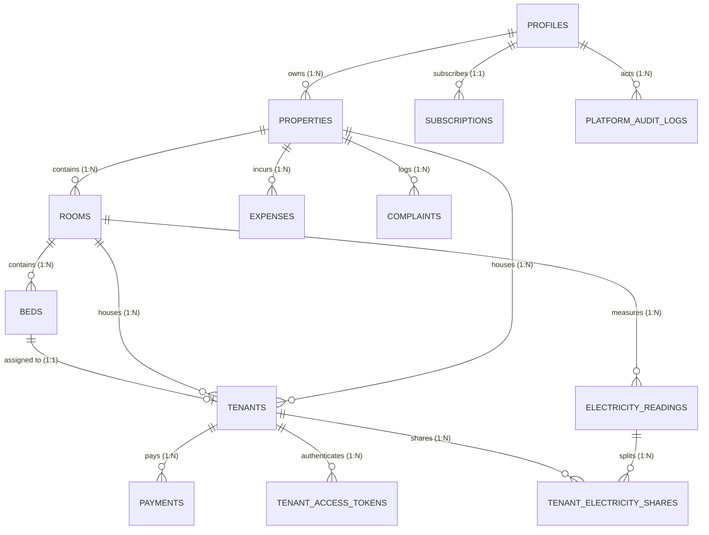

# BaseraBook — Comprehensive Database Architecture & Field Guide
**Document Version:** 1.0.0 (Production Verified)  
**Security Level:** Read-Only Reference / No Schema Modifications  
**Verified Against:** Live Supabase Database (`rjxcbglfebleogauzyys.supabase.co`) & `supabase/schema.sql`

---

## 1. Executive Overview & Data Architecture

BaseraBook is a multi-tenant PG, hostel, apartment, and rental property management platform. Multi-tenancy is enforced through the PostgreSQL `owner_id` (a Foreign Key to `public.profiles.id` linked directly to `auth.users.id`) and PostgreSQL Row-Level Security (RLS) policies.

### Hierarchy & Entity Relationships


---

## 2. Table Catalog & Detailed Data Dictionary

### 2.1 `public.profiles`
- **Purpose:** Central user profile linked 1-to-1 with Supabase `auth.users`. Holds owner identities, roles, payment reception handles, and language preferences.
- **Authoritative Source for:** Owner name, contact phone, owner UPI ID / QR code / payment links, preferred language (`preferred_language`).
- **Columns:**
  | Column | Data Type | Nullable | Default | Description |
  | :--- | :--- | :--- | :--- | :--- |
  | `id` | `UUID` | No | `auth.uid()` | Primary Key, references `auth.users(id) ON DELETE CASCADE` |
  | `email` | `TEXT` | No | — | Owner email address |
  | `full_name` | `TEXT` | Yes | `''` | Owner full display name |
  | `phone` | `TEXT` | Yes | `NULL` | Owner 10–15 digit contact number |
  | `role` | `TEXT` | No | `'pg_owner'` | Authorization role: `'super_admin'`, `'pg_owner'`, or `'tenant'` |
  | `status` | `TEXT` | No | `'active'` | Account status: `'active'`, `'suspended'`, or `'pending'` |
  | `upi_id` | `TEXT` | Yes | `NULL` | Default UPI VPA for receiving tenant rent (e.g. `owner@upi`) |
  | `payment_link` | `TEXT` | Yes | `NULL` | Default online payment URL (e.g. Razorpay/custom link) |
  | `upi_qr_url` | `TEXT` | Yes | `NULL` | URL or base64 QR code image for tenant scan-and-pay |
  | `must_change_password` | `BOOLEAN` | Yes | `false` | First-time login mandatory password reset flag |
  | `mfa_enrolled` | `BOOLEAN` | Yes | `false` | Multi-Factor Authentication enrollment flag |
  | `preferred_language` | `TEXT` | Yes | `'en'` | Stored user preference (`'en'` or `'hi'`) |
  | `created_at` | `TIMESTAMPTZ`| No | `now()` | Record creation timestamp |
  | `updated_at` | `TIMESTAMPTZ`| No | `now()` | Record update timestamp |

---

### 2.2 `public.properties`
- **Purpose:** Represents individual real estate assets (PG building, hostel, apartment building, rental house).
- **Authoritative Source for:** Property name, property address, contact details, house rules, and property-specific payment details.
- **Columns:**
  | Column | Data Type | Nullable | Default | Description |
  | :--- | :--- | :--- | :--- | :--- |
  | `id` | `UUID` | No | `gen_random_uuid()` | Primary Key |
  | `owner_id` | `UUID` | No | — | Foreign Key -> `profiles(id) ON DELETE CASCADE` |
  | `name` | `TEXT` | No | — | Human-readable property name (e.g., "Sunrise PG") |
  | `address` | `TEXT` | Yes | `NULL` | Street address |
  | `city` | `TEXT` | Yes | `NULL` | City |
  | `state` | `TEXT` | Yes | `NULL` | State |
  | `pincode` | `TEXT` | Yes | `NULL` | Postal code |
  | `contact_number` | `TEXT` | Yes | `NULL` | Property-specific front desk/manager phone number |
  | `rules` | `TEXT` | Yes | `NULL` | House rules / notices (stored as JSON string or text) |
  | `upi_id` | `TEXT` | Yes | `NULL` | Property-level UPI ID override |
  | `payment_link` | `TEXT` | Yes | `NULL` | Property-level payment link override |
  | `upi_qr_url` | `TEXT` | Yes | `NULL` | Property-level QR code override |
  | `created_at` | `TIMESTAMPTZ`| No | `now()` | Timestamp created |
  | `updated_at` | `TIMESTAMPTZ`| No | `now()` | Timestamp updated |

---

### 2.3 `public.rooms`
- **Purpose:** Physical rooms or flats inside a property.
- **Authoritative Source for:** Room numbering, floor levels, room types (Single, Double, Triple, Four, Sharing), and base rent.
- **Columns:**
  | Column | Data Type | Nullable | Default | Description |
  | :--- | :--- | :--- | :--- | :--- |
  | `id` | `UUID` | No | `gen_random_uuid()` | Primary Key |
  | `owner_id` | `UUID` | No | — | Foreign Key -> `profiles(id) ON DELETE CASCADE` |
  | `property_id` | `UUID` | No | — | Foreign Key -> `properties(id) ON DELETE CASCADE` |
  | `room_number` | `TEXT` | No | — | Human-readable room label (e.g., "101", "A-2") |
  | `floor` | `INTEGER` | Yes | `0` | Floor number (0 = Ground, 1 = 1st floor) |
  | `room_type` | `TEXT` | Yes | `'sharing'` | Type: Single, Double, Triple, Four, Sharing |
  | `base_rent` | `NUMERIC(10,2)`| Yes | `0` | Default monthly rent benchmark for the room |
  | `created_at` | `TIMESTAMPTZ`| No | `now()` | Timestamp created |
  | `updated_at` | `TIMESTAMPTZ`| No | `now()` | Timestamp updated |

---

### 2.4 `public.beds`
- **Purpose:** Individual beds/slots inside a room for PG and hostel properties.
- **Authoritative Source for:** Bed inventory and occupancy state (`available`, `occupied`, `maintenance`).
- **Columns:**
  | Column | Data Type | Nullable | Default | Description |
  | :--- | :--- | :--- | :--- | :--- |
  | `id` | `UUID` | No | `gen_random_uuid()` | Primary Key |
  | `owner_id` | `UUID` | No | — | Foreign Key -> `profiles(id) ON DELETE CASCADE` |
  | `property_id` | `UUID` | No | — | Foreign Key -> `properties(id) ON DELETE CASCADE` |
  | `room_id` | `UUID` | No | — | Foreign Key -> `rooms(id) ON DELETE CASCADE` |
  | `bed_number` | `TEXT` | No | — | Label within room (e.g., "A", "B", "1", "2") |
  | `status` | `TEXT` | No | `'available'` | State: `'available'`, `'occupied'`, `'maintenance'` |
  | `monthly_rate`| `NUMERIC(10,2)`| Yes | `0` | Monthly rate for this specific bed |
  | `created_at` | `TIMESTAMPTZ`| No | `now()` | Timestamp created |
  | `updated_at` | `TIMESTAMPTZ`| No | `now()` | Timestamp updated |

---

### 2.5 `public.tenants`
- **Purpose:** Primary resident / tenant record.
- **Authoritative Source for:** Resident identity, phone, room and bed assignment, monthly rent amount, security deposit, move-in joining date (`joining_date`), rent due day of month (`rent_due_day`), and tenancy status (`Paid`, `Pending`, `Overdue`, `Vacated`).
- **Columns:**
  | Column | Data Type | Nullable | Default | Description |
  | :--- | :--- | :--- | :--- | :--- |
  | `id` | `UUID` | No | `gen_random_uuid()` | Primary Key |
  | `owner_id` | `UUID` | No | — | Foreign Key -> `profiles(id) ON DELETE CASCADE` |
  | `property_id` | `UUID` | Yes | `NULL` | Foreign Key -> `properties(id) ON DELETE SET NULL` |
  | `room_id` | `UUID` | Yes | `NULL` | Foreign Key -> `rooms(id) ON DELETE SET NULL` |
  | `bed_id` | `UUID` | Yes | `NULL` | Foreign Key -> `beds(id) ON DELETE SET NULL` |
  | `full_name` | `TEXT` | No | — | Resident full name |
  | `email` | `TEXT` | Yes | `NULL` | Resident email address |
  | `phone` | `TEXT` | Yes | `NULL` | Resident mobile phone number |
  | `emergency_contact` | `TEXT` | Yes | `NULL` | Emergency contact name & phone |
  | `id_proof_type` | `TEXT` | Yes | `NULL` | KYC document type (e.g., Aadhaar, PAN, Passport) |
  | `id_proof_number` | `TEXT` | Yes | `NULL` | Masked KYC document number |
  | `monthly_rent` | `NUMERIC(10,2)`| No | `0` | Agreed monthly rent payable |
  | `security_deposit`| `NUMERIC(10,2)`| Yes | `0` | Refundable security deposit collected |
  | `joining_date` | `DATE` | No | `CURRENT_DATE`| Resident move-in / agreement start date |
  | `rent_due_day` | `INTEGER` | Yes | `5` | **Authoritative recurring day of month (1–31)** when monthly rent is due |
  | `status` | `TEXT` | No | `'Pending'` | Tenancy status: `'Paid'`, `'Pending'`, `'Overdue'`, `'Vacated'` |
  | `deleted_at` | `TIMESTAMPTZ`| Yes | `NULL` | Soft-deletion timestamp for 30-day trash recovery |
  | `created_at` | `TIMESTAMPTZ`| No | `now()` | Timestamp created |
  | `updated_at` | `TIMESTAMPTZ`| No | `now()` | Timestamp updated |

---

### 2.6 `public.payments`
- **Purpose:** Ledger of all payments recorded (rent payments, security deposits, electricity collections).
- **Authoritative Source for:** Rent payment history, receipts, payment methods (UPI, cash, bank transfer), covered billing periods (`month_covered`), and payment timestamps.
- **Columns:**
  | Column | Data Type | Nullable | Default | Description |
  | :--- | :--- | :--- | :--- | :--- |
  | `id` | `UUID` | No | `gen_random_uuid()` | Primary Key |
  | `owner_id` | `UUID` | No | — | Foreign Key -> `profiles(id) ON DELETE CASCADE` |
  | `property_id` | `UUID` | Yes | `NULL` | Foreign Key -> `properties(id) ON DELETE SET NULL` |
  | `tenant_id` | `UUID` | Yes | `NULL` | Foreign Key -> `tenants(id) ON DELETE SET NULL` |
  | `amount` | `NUMERIC(10,2)`| No | — | Payment amount in INR |
  | `payment_method` | `TEXT` | Yes | `'upi'` | `'upi'`, `'cash'`, `'bank_transfer'`, `'card'`, `'other'` |
  | `payment_type` | `TEXT` | Yes | `'rent'` | `'rent'`, `'deposit'`, `'electricity'`, `'maintenance'`, `'other'` |
  | `transaction_reference` | `TEXT`| Yes | `NULL` | Bank UTR, UPI transaction reference number |
  | `notes` | `TEXT` | Yes | `NULL` | Internal notes or remarks |
  | `month_covered` | `TEXT` | Yes | `NULL` | **Authoritative billing period** (e.g. `'October 2026'`, `'2026-10'`) |
  | `paid_at` | `TIMESTAMPTZ`| No | `now()` | Exact timestamp when payment was received |
  | `deleted_at` | `TIMESTAMPTZ`| Yes | `NULL` | Soft-deletion timestamp |
  | `created_at` | `TIMESTAMPTZ`| No | `now()` | Record creation timestamp |

---

### 2.7 `public.subscriptions`
- **Purpose:** Tracks owner subscription tiers, trial periods, and Razorpay subscription linkings.
- **Authoritative Source for:** Property limit entitlements (Trial: 2, Monthly: 2, Yearly: 5, Starter: 2, Growth: 5, Business: 9).
- **Columns:**
  | Column | Data Type | Nullable | Default | Description |
  | :--- | :--- | :--- | :--- | :--- |
  | `id` | `UUID` | No | `gen_random_uuid()` | Primary Key |
  | `owner_id` | `UUID` | No | — | Foreign Key -> `profiles(id) ON DELETE CASCADE` |
  | `plan` | `TEXT` | No | `'trial'` | `'trial'`, `'starter'`, `'growth'`, `'pro'`, `'business'`, `'monthly'`, `'yearly'` |
  | `status` | `TEXT` | No | `'trialing'` | `'trialing'`, `'active'`, `'past_due'`, `'canceled'`, `'expired'` |
  | `trial_start` | `TIMESTAMPTZ`| Yes | `now()` | Free trial start timestamp |
  | `trial_end` | `TIMESTAMPTZ`| Yes | `now() + 7 days` | Free trial end timestamp |
  | `current_period_start` | `TIMESTAMPTZ`| Yes | `NULL` | Paid subscription period start |
  | `current_period_end` | `TIMESTAMPTZ`| Yes | `NULL` | Paid subscription expiry/renewal timestamp |
  | `razorpay_customer_id` | `TEXT` | Yes | `NULL` | Razorpay Customer ID |
  | `razorpay_subscription_id` | `TEXT` | Yes | `NULL` | Razorpay Subscription ID (`sub_...`) |
  | `razorpay_plan_id` | `TEXT` | Yes | `NULL` | Razorpay Plan ID (`plan_...`) |
  | `razorpay_payment_id` | `TEXT` | Yes | `NULL` | Razorpay Payment ID (`pay_...`) |
  | `created_at` | `TIMESTAMPTZ`| No | `now()` | Created timestamp |
  | `updated_at` | `TIMESTAMPTZ`| No | `now()` | Updated timestamp |

---

### 2.8 `public.electricity_readings` & `public.tenant_electricity_shares`
- **Purpose:** Sub-meter tracking for rooms/units and mid-cycle prorated tenant billing shares.
- **Key Fields in `electricity_readings`:**
  - `previous_reading`, `current_reading`, `rate_per_unit`.
  - `total_units`: PostgreSQL generated column: `(current_reading - previous_reading)`.
  - `total_amount`: PostgreSQL generated column: `((current_reading - previous_reading) * rate_per_unit)`.
  - `is_settled`: Boolean indicating complete resident settlement.
- **Key Fields in `tenant_electricity_shares`:**
  - `reading_id`, `tenant_id`, `property_id`, `room_id`.
  - `occupied_days`, `total_period_days`, `share_percentage`, `amount_due`.

---

### 2.9 `public.complaints`, `public.expenses`, `public.tenant_access_tokens`
- **`complaints`:** Maintenance requests with `priority` (`High`, `Medium`, `Low`), `status` (`Open`, `In progress`, `Resolved`), and `resolved_at`.
- **`expenses`:** Operating expenditures with `category` (`maintenance`, `electricity`, `water`, `groceries`, `wifi`, `salary`, `cleaning`, `tax`, `other`), `amount`, and `expense_date`.
- **`tenant_access_tokens`:** Secure cryptographic access tokens for the resident self-service portal (`/portal?token=...`). Stores SHA-256 `token_hash`, `token_preview`, `expires_at`, `revoked_at`, and `last_accessed_at`.

---

## 3. Authoritative Sources for Critical Business Logic

### Rent Due Date Architecture
1. **Database Source of Truth:**
   - The authoritative stored field is **`public.tenants.rent_due_day`** (`INTEGER` between 1 and 31).
   - In conjunction with **`public.tenants.joining_date`** (`DATE`), it determines the starting billing cycle and all recurring due dates.
2. **First Rent Due Date Calculation Law:**
   - If a resident joins on the 24th of October (`joining_date = '2026-10-24'`) and their agreed rent due day is the 5th (`rent_due_day = 5`):
     - Because `joiningDay (24) > rentDueDay (5)`, their first rent cycle is due on **5 November 2026**.
     - It CANNOT be 5 October 2026 (which was in the past before they moved in).
   - If a resident joins on the 2nd of October (`joining_date = '2026-10-02'`) and `rent_due_day = 5`:
     - Because `joiningDay (2) <= rentDueDay (5)`, their first rent cycle is due on **5 October 2026**.
3. **Application Queries & Handlers:**
   - Reading: `supabase.from('tenants').select('..., rent_due_day, joining_date, status, ...')` in [app/dashboard/page.tsx](file:///c:/Users/abhis/Desktop/pg%20ide/pg-management-saas-development/app/dashboard/page.tsx).
   - Updating: `updateTenantAction` in [app/dashboard/actions.ts](file:///c:/Users/abhis/Desktop/pg%20ide/pg-management-saas-development/app/dashboard/actions.ts) updating `rent_due_day` on `public.tenants`.

---

## 4. Safe Read-Only SQL Diagnostics (JOIN Examples)

> [!NOTE]
> All queries below are strictly read-only `SELECT` queries that use actual database foreign keys. Run these in the Supabase SQL editor to inspect readable names alongside UUIDs without making any changes.

### Query 1: Complete Resident Directory with Readable Names
Shows resident name, room number, bed number, property name, rent, and due schedule side-by-side:
```sql
SELECT
  t.id AS tenant_id,
  t.full_name AS resident_name,
  t.phone AS resident_phone,
  p.name AS property_name,
  COALESCE(r.room_number, 'Unassigned') AS room_number,
  COALESCE(b.bed_number, '—') AS bed_number,
  t.monthly_rent,
  t.security_deposit,
  t.joining_date,
  t.rent_due_day,
  CONCAT(t.rent_due_day, 'th of every month') AS recurring_due_schedule,
  t.status AS rent_status,
  t.created_at
FROM public.tenants t
LEFT JOIN public.properties p ON t.property_id = p.id
LEFT JOIN public.rooms r ON t.room_id = r.id
LEFT JOIN public.beds b ON t.bed_id = b.id
WHERE t.deleted_at IS NULL
ORDER BY p.name ASC, r.room_number ASC, t.full_name ASC;
```

---

### Query 2: Rent Due Date & Payment Audit
Cross-references residents with their actual payment ledger records to verify rent due consistency:
```sql
SELECT
  t.id AS tenant_id,
  t.full_name AS resident_name,
  p.name AS property_name,
  t.monthly_rent,
  t.rent_due_day,
  t.joining_date,
  t.status AS tenant_recorded_status,
  COUNT(pay.id) AS total_payments_count,
  COALESCE(SUM(pay.amount), 0) AS total_amount_paid,
  MAX(pay.paid_at) AS last_payment_date,
  MAX(pay.month_covered) AS latest_month_covered
FROM public.tenants t
LEFT JOIN public.properties p ON t.property_id = p.id
LEFT JOIN public.payments pay ON pay.tenant_id = t.id AND pay.deleted_at IS NULL AND pay.payment_type = 'rent'
WHERE t.deleted_at IS NULL
GROUP BY t.id, t.full_name, p.name, t.monthly_rent, t.rent_due_day, t.joining_date, t.status
ORDER BY t.rent_due_day ASC;
```

---

### Query 3: Multi-Tenant Room & Bed Inventory Audit
Audits room capacities, occupied beds, and assigned residents:
```sql
SELECT
  p.name AS property_name,
  r.room_number,
  r.room_type,
  r.base_rent,
  b.bed_number,
  b.status AS bed_status,
  t.full_name AS occupant_name,
  t.phone AS occupant_phone,
  t.status AS occupant_rent_status
FROM public.properties p
INNER JOIN public.rooms r ON r.property_id = p.id
INNER JOIN public.beds b ON b.room_id = r.id
LEFT JOIN public.tenants t ON t.bed_id = b.id AND t.deleted_at IS NULL AND t.status <> 'Vacated'
ORDER BY p.name, r.room_number, b.bed_number;
```

---

### Query 4: Owner Subscriptions & Property Entitlement Status
Inspects account tiers and property counts:
```sql
SELECT
  prof.id AS owner_id,
  prof.full_name AS owner_name,
  prof.email AS owner_email,
  sub.plan AS subscription_plan,
  sub.status AS subscription_status,
  sub.trial_end,
  sub.current_period_end,
  COUNT(prop.id) AS active_properties_count
FROM public.profiles prof
LEFT JOIN public.subscriptions sub ON sub.owner_id = prof.id
LEFT JOIN public.properties prop ON prop.owner_id = prof.id
GROUP BY prof.id, prof.full_name, prof.email, sub.plan, sub.status, sub.trial_end, sub.current_period_end;
```

---

## 5. Potential Improvements (Recommendation Only — No Changes Made)

1. **Explicit View Proposal (Optional Diagnostic):**
   A read-only view `v_tenant_directory` combining tenant, room, bed, and property names would simplify reporting queries:
   ```sql
   -- RECOMMENDATION ONLY — DO NOT RUN WITHOUT EXPLICIT APPROVAL
   -- CREATE OR REPLACE VIEW public.v_tenant_directory AS ...
   ```
2. **Explicit `first_due_date` column on `public.tenants` (Future Proposal):**
   Currently, the application computes the first due date deterministically from `joining_date` and `rent_due_day`. If owners ever need to set an arbitrary first due date independent of joining date and due day, an additive column `first_due_date DATE DEFAULT NULL` could be proposed in a future migration.
